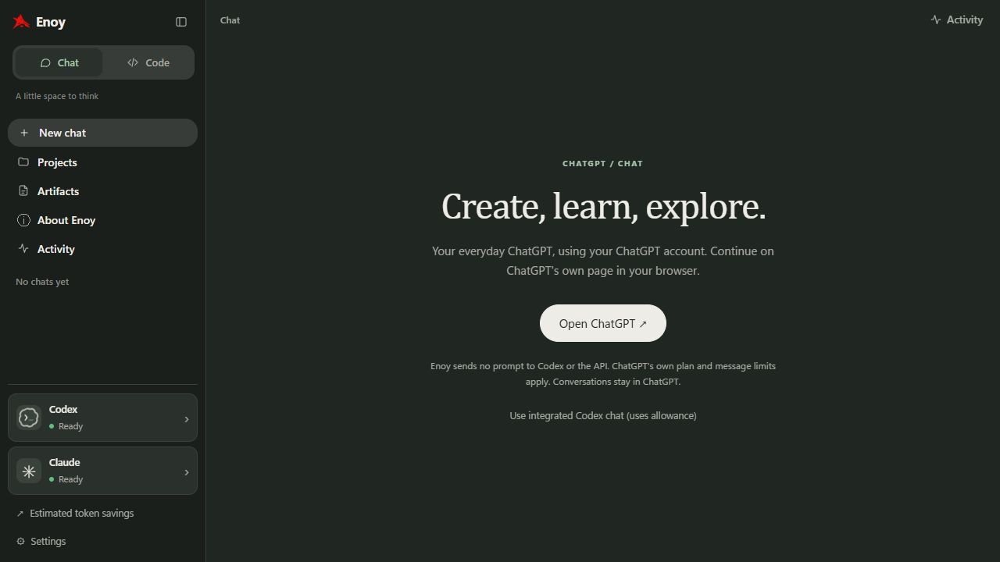
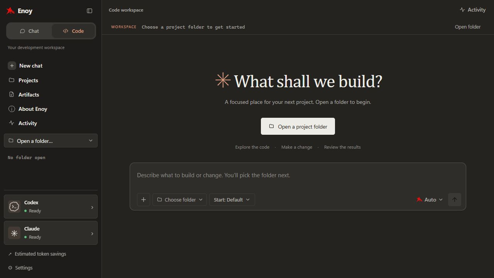

# Enoy

Enoy is a Windows desktop app where ChatGPT evaluates your request,
assigns development tasks to Codex or Claude, and reviews the real results.
Both providers share recent conversation, attached images, task outputs, activity,
and permitted project files through Enoy. Dark mode is the default.

## Download and start (Windows 10/11, x64)

**[Download Enoy for Windows](https://github.com/anglerequip/Enoy/releases/latest/download/Enoy-Setup-x64.exe)** · [Release notes](https://github.com/anglerequip/Enoy/releases)

1. Download and run **Enoy-Setup-x64.exe**. Python and the app dependencies are included.
2. Keep **Install missing Codex, Claude Code and WebView2** selected. Setup downloads missing tools from their official publishers; internet is required.
3. Open Enoy → **Settings → General → Accounts and setup**. Use **Connect Codex** and **Connect Claude**, then **Launch & sign in** for each missing sign-in. Complete the browser sign-in using your own accounts.
4. Use **Chat** for ordinary conversations or **Code** to open a project folder.

ChatGPT Plus includes Codex CLI access; Claude Pro includes Claude Code. Model access and usage remain subject to each provider's account limits. No Enoy subscription or separate API key is required for subscription sign-in. See [Codex plans](https://learn.chatgpt.com/docs/pricing) and [Claude Code setup and access](https://code.claude.com/docs/en/setup).

The installer is currently unsigned, so Windows may display a publisher or SmartScreen warning. Download it only from this repository's Releases. Each release includes a SHA-256 checksum. This is an early app, not a security-audited product; use version control or backups when letting agents edit projects.

## Chat and Code

| Chat | Code |
| --- | --- |
| Softer buttons, warm green surfaces, and **regular ChatGPT** for creating, learning and exploring. | Warm, Claude-inspired workspace, serif heading, focused composer, visible folder path and project tools. |
| **Open ChatGPT** opens the normal ChatGPT website in your browser. Enoy sends no prompt to Codex or the API. ChatGPT's own account/message limits still apply. Conversations stay in ChatGPT. | Keeps the configured planning model and automatic execution routing. |




In **Settings → General → Chat experience**, you can explicitly opt into integrated Codex chat instead. That option defaults to GPT-6 Luna / low effort and uses your Codex allowance. Existing Enoy conversations remain available; continuing them inside Enoy requires selecting integrated chat. Normal ChatGPT conversations are not imported or copied automatically.

Choose a custom **Start** model before any integrated message. Integrated Chat model defaults can also be changed in **Settings → Models**. Regular ChatGPT's model is selected on ChatGPT's own page. Switching modes and pressing New chat stay inside Enoy. Only **Open ChatGPT** opens the browser.

## Colours and motion

**Settings → Colours** offers 12 presets (Clay, Sage, Graphite, Ocean, Lavender, Rose, Amber, Teal, Forest, Indigo, Coffee and High contrast), with separate choices for Chat and Code. Customize the accent, background, sidebar and cards/composer, or reset a workspace to its defaults. Preferences and the light/dark/system setting are saved in app data and survive restarts and updates.

Chat/Code switching uses a sliding tab and a short directional transition. Windows reduced-motion preferences are respected. Imported general-chat data folders are recognized as Chat history instead of appearing among Code workspaces.

## Updates

Every successful push to `main` runs the Windows tests, build and installer smoke check, then publishes a stable GitHub release. Once that workflow finishes, **Settings → General → Check for updates** can find the new version. Enoy downloads the installer, verifies its SHA-256 checksum, backs up the database and settings, then installs and restarts automatically. Finish running tasks first. Checks happen only when requested; there is no background polling of GitHub.

App files are installed under `%LOCALAPPDATA%\Programs\Enoy`. Chats, settings and attachments remain under `%LOCALAPPDATA%\Enoy`; update backups are in its `update-backups` folder. Provider CLIs manage their own updates. Optional Blender integration requires separate Blender/MCP setup and is not needed for ordinary Chat or Code.

If setup was interrupted, use **Install missing tools** in General settings, then check each provider's status. Signing in doesn't send a model request. Claude's live usage panel can show when a plan limit prevents a request.

For source development, install Python 3.11+ and run **Setup Enoy.cmd**; provider CLI installation remains separate for source checkouts.

The only providers are **Codex** and **Claude**. There is no local-model
provider, model download, model server, or automatic local fallback. The previous
local-model integration has been removed. An unavailable Claude task can transfer
to Codex, with the reason recorded in Activity.

Native project tools are enabled by default for both providers. In a selected
project, ChatGPT and Claude can inspect files, edit code, and execute commands
and tests. Codex uses its workspace-write sandbox and automatic approval review;
Claude uses its auto permission mode. Tool activity appears in Activity while
the request runs, including command outcomes and output previews.
Settings → Models provides **Workspace Access** (the default) and explicitly
enabled **Full Access**. Workspace Access works in the selected project; general
chats have folder discovery and authoritative Enoy source paths. Full Access also
works from general chats and authorizes agents to find and work on other projects
under Enoy's Windows account. Codex uses its supported `danger-full-access`
sandbox policy with `on-request` approvals; Claude retains automatic permission
review. Neither mode bypasses provider approvals, Windows permissions, or grants
administrator rights. Provider policies can still reject an action; the actual
failure is shown in the chat. A CLI approval that cannot be handled in print mode
is a reported limitation, not an approved action.

Native provider sessions continue across follow-up messages, scoped to the chat,
workspace, model, reasoning setting and permission mode. Switching that scope
starts a fresh native session; both providers still receive Enoy's shared chat,
task and activity context. Large shared-context records explicitly mark omitted
text; native session history and tool results remain managed by the provider.
ChatGPT defaults to gpt-6.1-sol with
medium reasoning effort for planning and review. Simple edits use GPT-6 Luna at
low effort; Luau, Blender and VFX scripting use Sol at medium effort. Visual
Blender inspection uses Terra at medium effort, and explicitly unresolved,
exceptional problems use Astra at high effort. Claude Opus 5.5 handles game
design and architecture at medium effort and difficult debugging/final review
at high effort; Claude Code's current Sonnet alias handles VFX art direction.
By default Claude reviews
GPT's implementation plan before any workers start, handles complex implementation
and repairs, then reviews the actual results. Claude may approve or replace the
plan; revised plans undergo the same dependency and path validation. Automatic
tests remain the source of test outcomes. Settings → Models controls these roles.

The composer supports app-level slash commands: `/help`, `/compact`, `/new`,
`/model`, `/status` and `/resume`. `/compact` saves a continuation brief, resets
native provider sessions and omits earlier transcript turns from future provider
context; the full chat remains visible and saved. Add a short focus note after
`/compact` to carry it into the continuation brief.

Claude quota failures, disabled access, declined consent and request budgets are
reported explicitly. When Claude is unavailable, implementation falls back to
GPT, the plan is marked as not Claude-reviewed, and GPT performs the final review.
An unavailable economical GPT model falls back to Sol. Per-run Claude confirmation
is respected when enabled; choosing an automatic Claude workflow can turn it off
in Settings. Model switching and fallback decisions appear in Activity.

Enoy currently routes text and code through the Codex and Claude Code CLIs. The
GPT-Image-2.5 Flare and Sunburst roles in the recommended stack are not wired to
an image-generation service in Enoy; use a connected image tool separately.

The active model and effort appear beside the assistant's name. An open progress
summary beneath the response shows routing explanations, public assistant updates
and actual tool activity. These are public progress summaries, not private internal
chain of thought. No additional model request is made to generate that panel.
Completed-message model and progress metadata persist in transmission records.

Native edits are direct filesystem changes and do not create Enoy undo backups.
Delegated development tasks also use native tools, with observed filesystem diffs
returned to the coordinator for review. Native tasks share a working tree and run
one at a time so changes can be attributed reliably. The provider can use its own
supported tools and workflows within each task. Disabling native tools restores
patch proposals with Enoy's validation, backups, conflict checks and approvals.
No automatic commit or push is requested by Enoy.

Saved chats and settings live in `%LOCALAPPDATA%\Enoy` (`ENOY_HOME` overrides it).
Existing data from the earlier application name is imported without deleting the
original copy. Existing chat history retains its original provider attribution.

Cloud privacy exclusions apply to both providers. Configured private file filters
or private project documents disable native tools, preserving filtered context
access instead. A project or chat with cloud
access disabled can still be browsed and managed, but cannot make model requests.

## Development

Blender modelling is available to both providers through **Settings → Models →
Shared Blender workspace**. Both work on the same live scene with serialized
tool calls and shared handoff activity. See [Blender collaboration](docs/BLENDER.md)
for setup and the modelling workflow.

```
.venv\Scripts\python.exe -m enoy --verbose
.venv\Scripts\python.exe -m pytest -q
```

The current suite tests the cloud workflow, adapters, permissions, storage,
projects, artifacts and APIs with scripted providers. Tests of removed local-model
features are retained under `tests/retired/` and are excluded from collection.

See [Architecture](docs/ARCHITECTURE.md), [Collaboration](docs/COLLABORATION.md),
[Recovery](docs/RECOVERY.md), and [Troubleshooting](docs/TROUBLESHOOTING.md).
